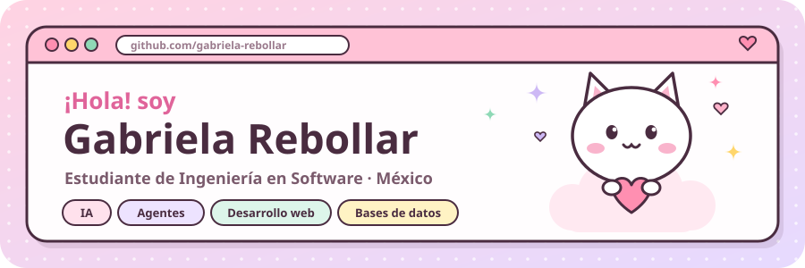
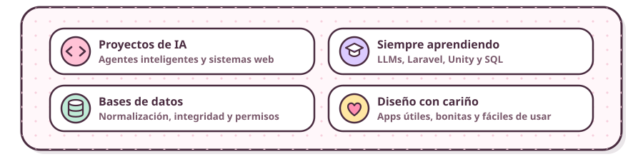
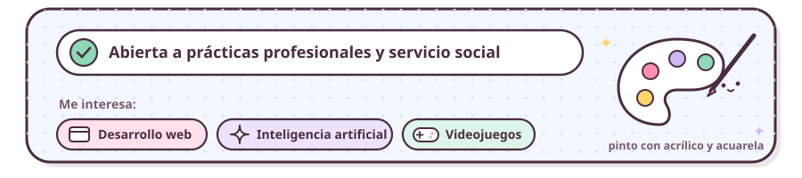
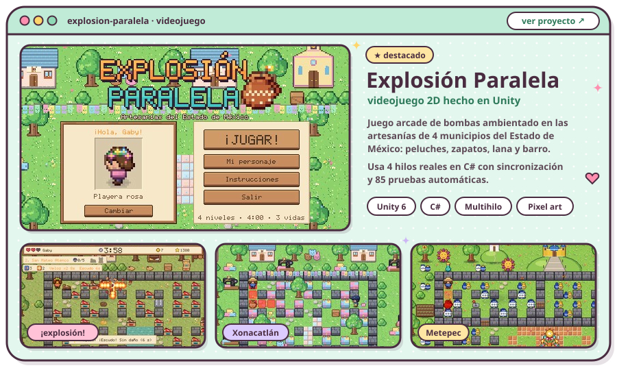
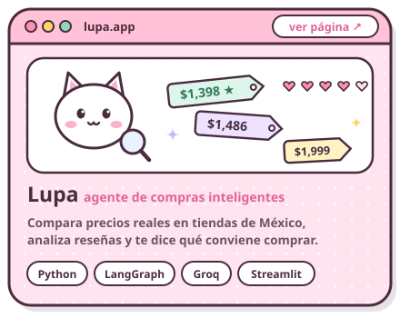
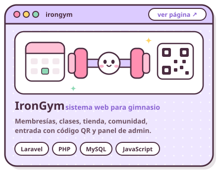

  

  
  

  
  

  

  

  
  

  
  &nbsp;
  
  &nbsp;
  

  

  <b>💗 Lenguajes</b> 
  
  
  
  
  
  
  

  <b>🌷 Web, datos e IA</b> 
  
  
  
  
  
  

  <b>🧸 Herramientas</b> 
  
  
  
  
  
  

  
  

  

